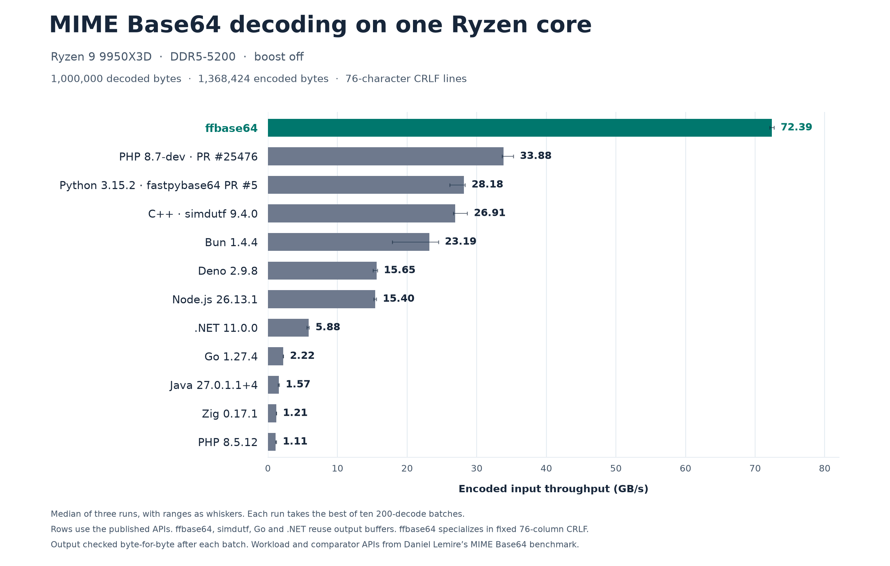
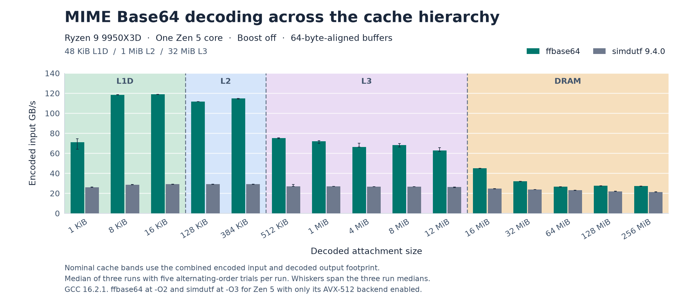

# ffbase64

[ffbase64](ffbase64.h) is a single-header C99 decoder for MIME Base64 with
76-character CRLF lines. On one Ryzen 9 9950X3D core with DDR5-5200 and boost
disabled, it decodes a 1 MB attachment at **72.39 GB/s** of encoded input.
That's **2.14×** the throughput of patched PHP and **2.69×** that of simdutf
9.4.0 on the same workload.



## Correctness and measurement

Each decoder received the same 1,368,424 encoded bytes for a 1,000,000-byte
attachment. Every decoded byte was checked against the original after each
timed batch. The chart shows the median and range of three runs. Each run
kept the fastest of ten 200-decode batches. ffbase64, simdutf, Go, and .NET
reused output buffers. The workload and comparator APIs follow
[Daniel Lemire's email attachment benchmark](https://lemire.me/blog/2026/11/20/decoding-base64-email-attachments/).

## Across the cache hierarchy

On the 9950X3D's 32 MiB L3 CCD, ffbase64 reaches **118.78 GB/s** at a 16 KiB
attachment, **4.09×** simdutf. At 256 MiB it sustains **27.09 GB/s** versus
**21.19 GB/s** for simdutf, a **28%** lead.



Both decoders reused the same aligned input and output buffers. The cache
bands use their combined footprint. Each of three runs took the median of five
trials with alternating decoder order and checked every decoded byte after
each timed batch.

## Build and test

```sh
./build.sh
./bench --check
./bench
```

The build defaults to GCC at `-O2` and accepts `CC`, `CFLAGS`, and `OUTPUT`.
The correctness checks cover small payloads, line endings, padding, and
output capacity. The benchmark times ffbase64 on a 1 MB attachment with
the same CRLF framing as the chart. It reports the median encoded GB/s
over three rounds, each taking the fastest of ten 200-decode batches
after warm-up. It checks the entire decoded buffer after each batch.

## Use ffbase64

Define `FFBASE64_IMPLEMENTATION` in one C translation unit and include the header.

```c
#define FFBASE64_IMPLEMENTATION
#include "ffbase64.h"
```

Include the header normally elsewhere. Build with GCC or Clang for x86-64.
The decoder selects AVX-512 VBMI at runtime and has a scalar path.

```c
size_t written = ffbase64_decode_mime76(input, size, output, capacity);
```

Each nonfinal line must contain exactly 76 Base64 characters followed by
`\r\n`. The final line may be shorter and its CRLF is optional. Off-cadence
line breaks and extra whitespace return `SIZE_MAX`, as does insufficient
output capacity. The buffers must be disjoint. On failure the output buffer
may have been modified. On success the function returns the number of bytes
written.

## How it works

The AVX-512 loop decodes four lines at a time. Fixed byte shuffles move the
CRLF pairs into known lanes. The same lookup translates Base64 characters
and tags line breaks so one vector check can validate the whole block.
Multiply-adds and a byte shuffle pack four symbols into three output bytes.
Masked vector loads handle the remaining lines and the unpadded tail.

On AMD family 1Ah, model 44h, the decoder issues destination `PREFETCHW`
starting at 16 MiB of decoded output and switches to non-temporal stores at
128 MiB. The streaming loop assembles full cache lines in registers and
writes them directly with `VMOVNTDQ`. At 256 MiB on the 9950X3D's V-Cache CCD
with DDR5-5200, dispatch delivers **27.22 GB/s**, or **95%** of a matched
streaming benchmark's **28.61 GB/s** at the same read/write ratio.
[Decoder measurements](experiments/nt-gap/ddr5-5200.csv) · [Streaming measurements](experiments/nt-gap/roofline.csv)
